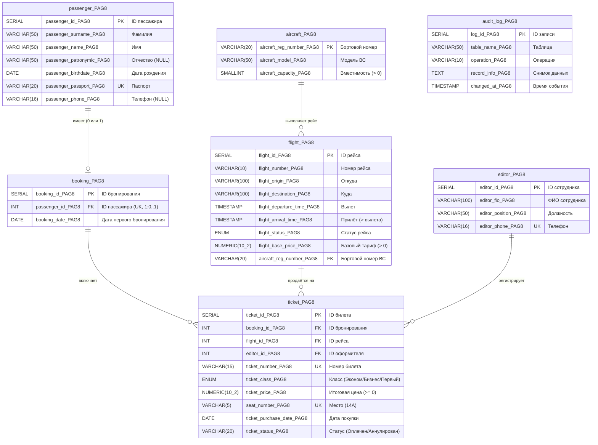

# ПОЯСНИТЕЛЬНАЯ ЗАПИСКА
**к расчётному заданию по дисциплине «Базы данных»**  
**Тема:** Информационная система расписания рейсов и продажи авиабилетов аэропорта (`_PAG8`)

---

## 1. Описание предметной области и актуальность

Информационная система (ИС) аэропорта предназначена для автоматизации учёта парка воздушных судов, ведения актуального расписания авиарейсов, управления тарифной политикой, регистрации пассажиров и оформления авиабилетов (как через кассовый терминал аэропорта, так и посредством онлайн-покупки пассажирами).

**Актуальность разработки:** ручной или слабоструктурированный учёт расписания и посадочных мест приводит к риску двойного бронирования одного кресла («овербукинга»), ошибкам при расчёте стоимости билетов различных классов обслуживания, продаже билетов на закрытые или уже вылетевшие рейсы, а также отсутствию аудита действий персонала. Перенос ключевых проверок целостности и бизнес-логики непосредственно на уровень реляционной СУБД PostgreSQL исключает повреждение данных независимо от клиентского интерфейса.

---

## 2. Функциональные требования и ролевая модель

В системе реализовано строгое разграничение доступа для четырёх категорий пользователей:

1. **Пассажир (`passenger`):**
   * самостоятельная регистрация в системе с проверкой формата паспортных данных;
   * просмотр публичного табло рейсов с фильтрацией по пунктам вылета и назначения;
   * онлайн-покупка билетов на рейсы со статусом «Регистрация» с каскадным выбором класса обслуживания и конкретного свободного места;
   * просмотр истории своих билетов и их возврат (аннулирование).
2. **Кассир (`cashier`):**
   * регистрация новых пассажиров в справочнике БД;
   * оформление и возврат авиабилетов для любого зарегистрированного пассажира с возможностью ручного переопределения базового тарифа;
   * просмотр общего реестра оформленных билетов.
3. **Диспетчер расписания (`dispatcher`):**
   * добавление новых авиарейсов с привязкой к конкретному воздушному судну;
   * оперативное управление статусами рейсов (`Регистрация`, `Задержан`, `Вылетел`, `Прибыл`, `Отменен`);
   * изменение базового тарифа рейса;
   * удаление ошибочно созданных рейсов (с триггерным запретом удаления вылетевших или прибывших рейсов).
4. **Администратор системы (`admin`):**
   * полный доступ ко всем функциям диспетчера и кассира;
   * управление учётными записями пользователей и назначение ролей;
   * просмотр финансовой аналитики рейсов (количество проданных билетов, процент загрузки борта, суммарная выручка);
   * контроль безопасности по журналу триггерного аудита БД.

---

## 3. Инфологическая и даталогическая модели данных (3НФ)

Схема базы данных спроектирована в третьей нормальной форме (3НФ) и включает 7 таблиц с суффиксом варианта `_PAG8`:

| № | Имя таблицы | Назначение | Первичный ключ (PK) | Внешние ключи (FK) и ограничения |
|---|---|---|---|---|
| 1 | `aircraft_PAG8` | Справочник воздушных судов | `aircraft_reg_number_PAG8` | `CHECK (aircraft_capacity_PAG8 > 0)` |
| 2 | `editor_PAG8` | Справочник сотрудников | `editor_id_PAG8` | `UNIQUE (editor_phone_PAG8)` |
| 3 | `passenger_PAG8` | Справочник пассажиров | `passenger_id_PAG8` | `UNIQUE (passenger_passport_PAG8)` |
| 4 | `flight_PAG8` | Расписание авиарейсов | `flight_id_PAG8` | `FK -> aircraft_PAG8`, `CHECK (arrival > departure)`, `CHECK (base_price > 0)` |
| 5 | `booking_PAG8` | Личный счёт бронирований пассажира | `booking_id_PAG8` | `FK -> passenger_PAG8` (`UNIQUE`, связь `1 : 0..1`) |
| 6 | `ticket_PAG8` | Оформленные авиабилеты | `ticket_id_PAG8` | `FK -> booking_PAG8, flight_PAG8, editor_PAG8`, `UNIQUE (flight_id, seat_number)` |
| 7 | `audit_log_PAG8` | Журнал аудита изменений БД | `log_id_PAG8` | Автономная таблица (защищена триггером от `DELETE`) |

**Обоснование соответствия 3НФ:**
* **1НФ:** все атрибуты атомарны (ФИО пассажира разделено на `surname`, `name`, `patronymic`; маршрут разделён на `origin` и `destination`).
* **2НФ:** все неключевые атрибуты полностью зависят от первичного ключа (пассажировместимость вынесена в справочник `aircraft_PAG8`, а не дублируется в строках `flight_PAG8`).
* **3НФ:** транзитивные зависимости устранены (персональные данные пассажира хранятся в `passenger_PAG8` и связываются с его билетами через единую запись бронирования `booking_PAG8`).

### Итоговая ER-диаграмма в нотации Мартина

---

## 4. Пользовательские типы данных, ограничения и индексы

1. **Перечисляемые типы (`ENUM`):**
   * `flight_status_type_PAG8`: `'Регистрация'`, `'Вылетел'`, `'Задержан'`, `'Прибыл'`, `'Отменен'`;
   * `ticket_class_type_PAG8`: `'Эконом'`, `'Бизнес'`, `'Первый'`.
2. **Ключевые ограничения целостности:**
   * проверка временного интервала полёта (`flight_arrival_time_PAG8 > flight_departure_time_PAG8`);
   * составной уникальный ключ `UNIQUE (flight_id_PAG8, seat_number_PAG8)` в таблице билетов, исключающий продажу одного места двум пассажирам на уровне ядра СУБД;
   * ограничение `UNIQUE (passenger_id_PAG8)` в таблице `booking_PAG8`, обеспечивающее кардинальность `1 : 0..1` (у пассажира без покупок — 0 записей бронирования, при первой покупке создаётся 1 запись бронирования, к которой привязываются все последующие билеты).
3. **B-tree индексы для оптимизации запросов:**
   * `idx_flight_route_time_PAG8` по `(flight_origin_PAG8, flight_destination_PAG8, flight_departure_time_PAG8)` — ускоряет поиск рейсов по маршруту и времени вылета;
   * `idx_ticket_flight_status_PAG8` по `(flight_id_PAG8, ticket_status_PAG8)` — ускоряет подсчёт свободных мест и выручки по рейсу;
   * `idx_passenger_surname_PAG8` по `(passenger_surname_PAG8)` — ускоряет поиск и сортировку пассажиров.

## 5. Представления (`VIEW`) и ролевая безопасность уровня СУБД

Чтение бизнес-данных из клиентского приложения выполняется исключительно через представления (`VIEW`):
* `v_public_schedule_PAG8` — агрегирует данные о рейсах, воздушных судах и динамически вычисляет количество свободных мест;
* `v_tickets_registry_PAG8` — формирует полный реестр билетов с расшифровкой маршрута, ФИО пассажира, паспорта и кассира;
* `v_passengers_list_PAG8` и `v_aircrafts_list_PAG8` — представления справочников для экранных форм;
* `v_audit_log_PAG8` — вывод последних 50 записей журнала аудита.

На уровне PostgreSQL созданы роли `role_passenger_pag8`, `role_cashier_pag8` и `role_dispatcher_pag8` с выдачей минимально необходимых привилегий (`GRANT SELECT`) на соответствующие представления.

---

## 6. Хранимые функции (`SQL` и `PL/Python`)

В системе реализовано 6 хранимых функций, включая 4 функции на процедурном языке **`plpython3u`**:

1. `fn_get_flight_revenue_PAG8(p_flight_id)` *(SQL, скалярная)* — вычисляет суммарную выручку по оплаченным билетам выбранного рейса.
2. `fn_flights_analytics_PAG8()` *(SQL, табличная)* — формирует сводный аналитический отчёт по всем рейсам (проданные билеты, выручка, процент загрузки салона).
3. `fn_py_validate_passport_PAG8(p_passport)` *(PL/Python)* — проверяет соответствие серии и номера паспорта РФ шаблону `^\d{4}\s\d{6}$`.
4. `fn_py_calc_dynamic_price_PAG8(p_base_price, p_ticket_class, p_load_percent)` *(PL/Python)* — рассчитывает итоговую стоимость билета с учётом коэффициента класса обслуживания (`Эконом` ×1.0, `Бизнес` ×1.8, `Первый` ×2.5) и загруженности салона (+10% при загрузке ≥ 50%, +25% при загрузке ≥ 80%).
5. `fn_py_validate_seat_PAG8(p_seat, p_capacity)` и `fn_py_get_seat_class_PAG8(p_seat)` *(PL/Python)* — проверяют существование кресла в компоновке конкретного типа самолёта (5 мест в ряду `A, C, D, E, F` для региональных бортов вместимостью < 120 мест и 6 мест `A–F` для среднемагистральных) и определяют класс обслуживания по ряду (1-й ряд — `Первый`, 2–4 ряды — `Бизнес`, 5+ ряды — `Эконом`).
6. `fn_get_available_seats_PAG8(p_flight_id)` *(PL/Python, табличная)* — генерирует перечень всех свободных кресел выбранного рейса с их классом и актуальной ценой.

---

## 7. Хранимые процедуры (`PROCEDURE`)

Все операции модификации данных (`INSERT`, `UPDATE`, `DELETE`) выполняются через хранимые процедуры:
* `sp_create_flight_PAG8`, `sp_update_flight_status_PAG8`, `sp_update_flight_price_PAG8`, `sp_delete_flight_PAG8` — управление расписанием и базовыми тарифами рейсов;
* `sp_register_passenger_PAG8` — регистрация нового пассажира;
* `sp_issue_ticket_PAG8` — транзакционное оформление билета: проверка наличия или создание единственной записи бронирования в `booking_PAG8`, определение класса по выбранному месту, расчёт цены через `PL/Python`, генерация номера билета `TKT-XXXXX` и вставка в `ticket_PAG8`;
* `sp_cancel_ticket_PAG8` и `sp_delete_ticket_PAG8` — возврат (аннулирование) и удаление билета.

---

## 8. Триггеры (`TRIGGER`) на все таблицы схемы

На каждую из 7 таблиц базы данных назначен триггер контроля целостности или аудита:

1. `trg_aircraft_audit_PAG8` (`AFTER INSERT OR UPDATE OR DELETE ON aircraft_PAG8`) — протоколирование изменений парка воздушных судов.
2. `trg_editor_audit_PAG8` (`AFTER INSERT OR UPDATE OR DELETE ON editor_PAG8`) — протоколирование изменений в справочнике сотрудников.
3. `trg_passenger_validate_PAG8` (`BEFORE INSERT OR UPDATE ON passenger_PAG8`) — блокировка вставки/обновления при некорректном формате паспорта (вызов `fn_py_validate_passport_PAG8`).
4. `trg_flight_protect_delete_PAG8` (`BEFORE DELETE ON flight_PAG8`) — запрет удаления рейсов со статусом `'Вылетел'` или `'Прибыл'`.
5. `trg_booking_audit_PAG8` (`AFTER INSERT OR DELETE ON booking_PAG8`) — аудит создания и удаления бронирований.
6. `trg_ticket_before_insert_PAG8` (`BEFORE INSERT ON ticket_PAG8`) — проверка перед продажей билета: статус рейса должен быть равен `'Регистрация'`, место должно существовать в компоновке борта (`fn_py_validate_seat_PAG8`), количество проданных билетов не должно превышать вместимость, с записью события в журнал аудита.
7. `trg_audit_protect_delete_PAG8` (`BEFORE DELETE ON audit_log_PAG8`) — защита журнала аудита от удаления записей.

---

## 9. Архитектура приложения и тестирование

Система построена по трёхзвенной архитектуре:
1. **Слой данных (PostgreSQL 15 + `plpython3u` в Docker):** автоматическое развёртывание схемы, представлений, функций, процедур и триггеров из скриптов `db/01_schema.sql` — `db/06_seed.sql`.
2. **Серверный слой (Python 3, FastAPI):** гибридный доступ к СУБД:
   * вся предметная логика выполняется через драйвер **DB-API (`psycopg2`)** путём вызова хранимых процедур (`CALL sp_...`) и чтения представлений (`SELECT * FROM v_...`);
   * **ORM (`SQLAlchemy`)** используется исключительно для управления таблицей учётных записей `app_users_pag8` и JWT-авторизации.
3. **Клиентский слой (React 18, TypeScript, Tailwind CSS):** одностраничное веб-приложение (SPA) с ролевой навигацией и каскадным выбором «Рейс → Класс обслуживания → Свободное место».

### Результаты тестирования
* Подтверждена блокировка триггерами СУБД попыток регистрации пассажира с неверным паспортом, продажи билета на закрытый/вылетевший рейс, выбора несуществующего места и удаления записей из журнала аудита.
* Подтверждена корректность динамического расчёта стоимости билетов и сохранения единого бронирования на пассажира (`1 : 0..1`).
* Проверено разграничение прав для всех четырёх ролей (`admin`, `dispatcher`, `cashier`, `passenger`).

